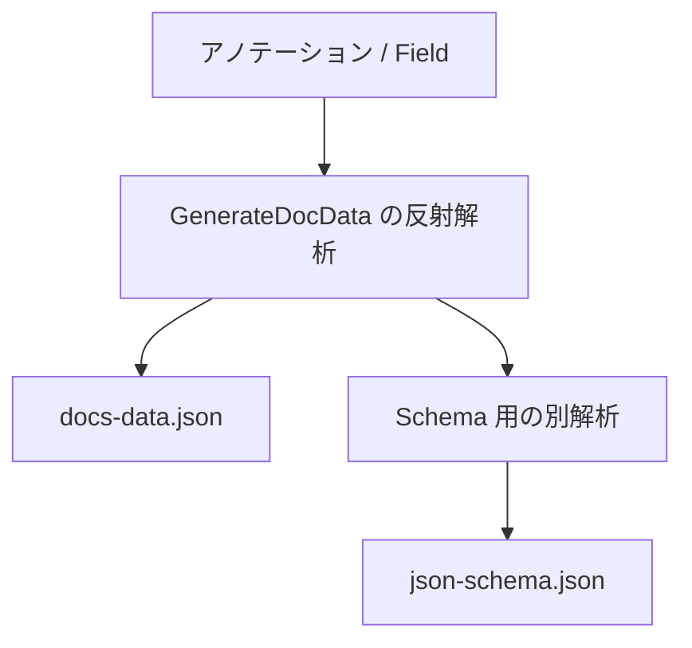
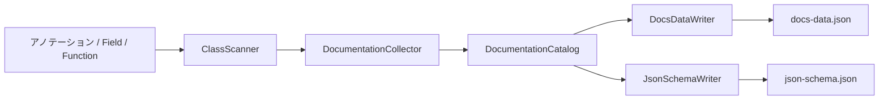

# GenDocs 解析モデル共通化・実装計画

## 目的

`GenDocs` が生成する `docs-data.json` と `json-schema.json` の解析処理を共通化し、Action / Element / 型 / 式関数の情報を一度だけ解決して複数形式へ出力できる構成にする。

この文書は実装順を定める計画書であり、ここに記したモデルやクラスは移行先の案である。現在の `GenerateDocData.kt` は両ファイルを生成しているが、ドキュメント項目の解析と Schema の型変換は一部別々に実装されている。

## 実装状況

2026-11-16 時点で、型付き設定モデル、論理 Ref、Catalog / Collector、クラススキャナー、2つの Writer、`GenerateDocData` の接続を実装済み。CI は生成物に差分がない場合に空コミットを作らず終了する。

GenDocs のコンパイルと fat JAR の生成は成功し、実データで Action 37件・Element 5件・Type 32件・Function 12件を出力した。Schema 内の `$ref` 84件はすべて解決し、連続生成で2つの JSON が同一ハッシュになることを確認した。`GiveItem.slot` は Enum / 整数 / null を受け入れ、Boolean を拒否する。`StoreData` / `RestoreData` はデータ項目配列、UUID の文字列型、未対応の `DATABASE` を確認する fixture を追加し、`RAW` / `FILE` の大文字小文字を区別しない挙動も検証した。`CustomSettable` の実装型を自動で Object 型として扱い、`@ParameterDoc` を付けた子フィールドを再帰収集して Schema に反映する。`Any` と `Display.Brightness` の型情報も補い、現在の `docs-data.json` に `Unknown` 型は0件。将来追加される未登録型を検知して警告する処理と、全 Action / Element および YAML サンプルの網羅的な Schema 適合テストは今後の作業として残る。

## 問題定義: Enum 値の Schema 検証

### 実行時の挙動

- `AdvancedConfigurationSection.get(path)` は文字列を `AdvancedConfiguration.evaluate` に渡す。式評価に失敗した場合は元の文字列を返す。
- `getEnum` は評価後の文字列を Enum 名と大文字小文字を区別せず照合する。一致しない場合、default 付き overload は default 値を返し、default なし overload は `null` を返す。
- Settable の Enum も `getString` の結果を Enum 名と照合する。
- したがって、通常の Enum 値に加えて、実行時に評価した結果が Enum 名になる式も有効になり得る。

### Schema の問題

Enum の型情報は現在 `Expression(Enum)` として表される。`JsonSchemaWriter` は Enum 候補に加えて一般の `string` を許可するため、候補にない通常の文字列も Schema を通る。エディターには候補が表示されても、Schema 検証ではタイプミスを検出できず、実行時に default / `null` へフォールバックすることがある。

問題は式入力を許可していること自体ではなく、「実行時の式評価結果が Enum 値になる入力」と「評価しても候補に一致しない通常の文字列」を Schema の型情報で区別できていないことにある。Schema は実行時パラメーターを使った式の評価結果までは判定できない。

### 解決時に満たす契約

1. Enum の通常値は、大文字小文字を区別せず候補値で検証する。
2. 実行時にサポートされる式入力を Schema が不必要に拒否しない。
3. 候補外の通常リテラルを Schema が有効な Enum 値として扱わない。
4. 式の評価結果が候補に一致するかは実行時に決まるため、Schema が保証できる範囲と実行時の default / `null` フォールバックを区別して説明する。
5. literal の正誤、大文字小文字、式入力、評価結果が候補外になる式を fixture で検証する。

`JsonSchemaWriter` の Enum 式入力は、通常の Enum 候補に加え、`${...}`、`@function`、引用文字列、演算子、括弧などの評価構文を含む文字列を許す。Schema は式を評価できないため、構文上の式を許すことと評価結果が Enum 候補になることは別の保証として扱う。この構文パターンは実行時 evaluator の変更時に合わせて見直す。

## 現状と改修理由

現在の生成経路は概ね次のとおり。



共通化する主な理由は次のとおり。

- `docs-data.json` の `checkField` と Schema 側の `collectDocumentedFields` が別々にフィールドを再帰解析している。入れ子、継承、`Settable.childOnly`、`CustomSettable` の扱いがずれる可能性がある。
- Schema の型変換が `ParameterType.name` の文字列を `when` で判定している。型名変更が Schema の意味に影響する。
- `parameterTypeDocs` は可変 `HashMap` で、Enum の型情報を解析中に追加する。出力順とレジストリの状態が生成順に左右される。
- `ref(name)` と `schemaName()` が Schema 内部の文字列を直接組み立てる。名前の衝突、参照先の存在確認、Schema Draft の変更を扱いにくい。
- パラメータ名は docs-data ではドット区切りの文字列、Schema では入れ子の Property として別々に扱う。
- クラススキャンは `packageName` の部分文字列を含むクラスを拾い、`JarFile` のクローズや IDE のクラスディレクトリを考慮していない。
- 出力先が作業ディレクトリ固定で、生成順を正規化する仕組みがない。

## 目標アーキテクチャ



`DocumentationCollector` が反射を担当し、両 Writer は `DocumentationCatalog` だけを入力としてシリアライズする。Writer から Field やアノテーションを直接読まない。

## モデル設計

### 1. 型情報を Schema 非依存の値として表す

`Documentations.kt` の `ConfigurationType` を拡張し、利用者設定上の型を文字列名ではなく型付き値で表す。

```kotlin
sealed interface ConfigurationType {
    data object Any : ConfigurationType
    data object String : ConfigurationType
    data object Boolean : ConfigurationType
    data object Integer : ConfigurationType
    data object Number : ConfigurationType
    data object Object : ConfigurationType
    data class Enum(val values: List<String>) : ConfigurationType
    data class Array(
        val item: ConfigurationType,
        val acceptInlineString: Boolean = false,
    ) : ConfigurationType
    data class Ref(val target: DocumentationRef) : ConfigurationType
}
```

必要に応じて `nullable` や「文字列式を受け付ける」属性も型メタデータに加える。たとえば整数パラメータの Schema は `Integer` と `String` のどちらも受け入れる、といった設定仕様を Writer の名前判定に埋め込まない。

`ParameterType` は表示名・説明・例に加えて、この `ConfigurationType` と Enum の候補値などを保持する。Enum の候補は例文を解析して作らず、型メタデータとして明示する。未知の型は `Any` 相当として扱い、生成を失敗させず警告を残す。

### 2. 論理参照 `DocumentationRef` を定義する

参照は JSON Schema の `$ref` 文字列ではなく、定義を識別する Schema 非依存の値とする。

```kotlin
enum class DocumentationNamespace(val key: String) {
    ACTION("action"),
    ELEMENT("element"),
    TYPE("type"),
    INTERNAL("internal"),
}

data class DocumentationRef(
    val namespace: DocumentationNamespace,
    val id: String,
)
```

ID は設定ファイルで使われる安定した公開名を使う。Action は `ClassDoc.name`、Element は `ClassDoc.name` を使い、名前空間によって同名を区別する。

```text
DocumentationRef(ACTION, "Message")  -> action:Message
DocumentationRef(ELEMENT, "Text")    -> element:Text
DocumentationRef(INTERNAL, "action-item") -> internal:action-item
```

JSON Schema の `definitions` キーも同じ論理キーから作る。Draft-07 では `#/definitions/{key}` に変換し、JSON Pointer の各トークン内にある `~` と `/` をそれぞれ `~0`、`~1` にエスケープする。`$defs` など別 Draft の表現へ移行する場合も、変更範囲は Schema Writer に限定する。

Collector または Catalog 構築時に、同一名前空間内の ID 重複、未登録参照、予約済み `INTERNAL` ID の衝突をエラーとして検出する。`action:Message` のような論理 ID を docs-data に追加する場合は、既存 JSON の利用者互換性を確認し、必要なら出力形式をバージョン管理する。

Action リストは `Array(Ref(INTERNAL, "action-item"))` として表す。`action-item` は各既知 Action の参照と、未ドキュメントの拡張 Action を許容する汎用定義をまとめる内部定義とする。

### 3. 正規化済み中間モデルを定義する

中間モデルには反射オブジェクトや Gson の `JsonObject` を持ち込まない。例として次の構造を使う。

```kotlin
data class ResolvedParameter(
    val path: List<String>,
    val description: String,
    val defaultValue: String?,
    val type: ConfigurationType,
    val nullable: Boolean,
    val required: Boolean,
    val examples: List<String> = emptyList(),
)

data class ResolvedClassDoc(
    val ref: DocumentationRef,
    val name: String,
    val description: String,
    val kind: DocumentationKind,
    val parameters: List<ResolvedParameter>,
)

data class DocumentationCatalog(
    val classes: List<ResolvedClassDoc>,
    val types: List<ResolvedTypeDoc>,
    val functions: List<ResolvedFunctionDoc>,
    val definitions: Map<DocumentationRef, ResolvedDefinition>,
)
```

`path` は構造化されたセグメント列を正とする。`docs-data.json` の既存 `name` が必要とする場合は Writer が `path.joinToString(".")` に変換する。Schema Writer は各セグメントを順番に子 Property として展開する。

キー解決は設定の実行規則に合わせて一箇所に実装する。`@Settable` のフィールドは実行時と同じく `Settable.name` が空ならフィールド名を使う。Action など `Settable` を使わず設定を直接読むクラスでは、現在の `ParameterDoc.name` とフィールド名の規約を維持する。Element と Action で規則が異なる場合は `DocumentationKind` に応じた Resolver とし、推測で共通ルールに押し込まない。

入れ子名を `path` にする際は、`Settable.childOnly` の親キーをセグメントとして追加する。明示名に `.` が含まれる場合は実行時の設定 API がドットを階層として扱うかを確認し、その挙動を fixture に固定する。

## 実装手順

### Phase 0: 現在の出力契約を固定する

1. 生成済み `docs-data.json` と `json-schema.json` のトップレベル構造、カテゴリ、必須プロパティ、Action / Element 名を記録する。
2. 代表例として、単純な文字列・数値・Boolean・Enum・Action リスト・入れ子 Settable・CustomSettable・継承フィールド・Expression 対応値を fixture にする。
3. `docs-data.json` は既存の項目名・順序以外の形を保ち、必要な新項目は利用者側の読み込み先を調べてから追加する。
4. 現在の Schema が許容する未知 Action / Element の汎用定義と、root の Action 設定・Element プリセットの両方を扱う挙動を記録する。

### Phase 1: 中立な型と参照モデルを追加する

1. `ConfigurationType` に Integer / Number / Object / Enum / Ref など必要な型を追加する。
2. `DocumentationNamespace`、`DocumentationRef`、`DocumentationKind` を `documentation` パッケージに追加する。
3. `ParameterType` の各組み込み型と Enum 登録を型付きメタデータへ移行する。
4. 可変 `parameterTypeDocs` への解析時追加をなくす。登録済みの型を明示的な Registry から読み、生成時に発見した Enum は Catalog 内のローカル一覧へ追加する。
5. 登録順を固定し、Registry が外部から不用意に変更されない形にする。

### Phase 2: 中間モデルと Catalog を追加する

1. `ResolvedParameter`、`ResolvedClassDoc`、`ResolvedTypeDoc`、`ResolvedFunctionDoc` を追加する。
2. `ResolvedParameter.path` は `List<String>` とし、Writer にドット文字列の解釈をさせない。
3. `DocumentationCatalog` に出力に必要な Action / Element / 型 / 関数と定義参照を格納する。
4. Catalog 構築時に ID 重複、重複パラメータ path、親ノードと値ノードの競合、未解決 Ref を検出する。

### Phase 3: クラススキャンと Collector を実装する

1. `GenerateDocData` からクラス探索を `ClassScanner` に切り出す。
2. クラスディレクトリと JAR の両方を扱い、JAR は `use` で閉じる。
3. パッケージの一致条件を完全修飾名の境界一致にする（`packageName` 自体または `packageName + "."` で始まるクラス）。
4. スキャン結果と各カテゴリの出力順をクラス名・公開名でソートする。
5. `DocumentationCollector` が `ClassDoc`、`ParameterDoc`、`Settable`、`CustomSettable`、継承フィールド、Enum 値、Function の情報を一度だけモデルへ解決する。
6. `Settable.childOnly` は実行時の仕様どおり、そのフィールドの設定セクション内へ再帰する。`CustomSettable` の再帰方法も実装の `load` と設定型変換に照らして定義する。
7. 再帰時は訪問済みクラスの集合を使い、循環型で無限再帰しないようにする。
8. 既存の `docs-data` 解析と Schema 解析で異なる箇所を fixture と比較し、意図した統一ルールを明記する。単なる実装都合で Action と Element のフィールドを同じように再帰しない。
9. `AbstractFunction` は既存の no-arg constructor 契約を維持して情報を読み取る。関数パラメータの `index.name` 形式は docs-data の互換性を保つ。

### Phase 4: 設定キー・型解決を一本化する

1. `ConfigurationKeyResolver` を作り、設定種別ごとの実効キーを解決する。
2. `Settable` があるフィールドは `Settable.name`、空ならフィールド名を実行時のキーとする。
3. `Settable` を使わない Action / Function の項目は現行の `ParameterDoc.name` を優先し、空ならフィールド名または現在の関数名規則を使う。
4. `ParameterDoc.type` に明示型がある場合はそれを採用し、無指定ならフィールド型を使う。
5. 型解決は `KClass` / `Class` から `ConfigurationType` へ一度だけ行う。`ParameterType.name` 文字列を分岐条件に使わない。
6. `Actions` / `AsyncActions` は `Array(Ref(INTERNAL, "action-item"))`、StringList は文字列配列とインライン文字列の union として明示する。Enum は上記の問題定義に沿って、候補値と式入力の許容範囲を型メタデータに表す。
7. 型メタデータで表現しきれない値は明示的に `Any` とし、生成ログにクラス名とフィールド名を出す。

### Phase 5: Writer を分離する

1. `DocsDataWriter` を追加し、Catalog から既存の配列構造、Action / Element / Type / Function の各カテゴリを出力する。
2. dotted name、説明、default、type 名など既存フィールドの表現を維持する。Schema 専用の Ref や内部定義は docs-data の公開契約に混ぜない。
3. `JsonSchemaWriter` を追加し、`ConfigurationType` を Draft-07 Schema に変換する。
4. `DocumentationRef` は Writer 内で `#/definitions/...` に変換する。定義登録と参照生成に同一の `definitionKey(ref)` 関数を使う。
5. Schema で数値 / Boolean と式文字列を受け入れる規則、Enum 値、配列要素、nested object、default、description を型メタデータから出す。
6. Action / Element の discriminator (`class` / `type`) は必須のままにする。未知の Action / Element を受け入れる汎用定義も維持する。
7. 現在の単一 `json-schema.json` の root 形状を維持する。Action 用と Element 用の Schema 分割は、利用者側の要件が確認できた段階で別変更として判断する。

### Phase 6: `GenerateDocData` をオーケストレーターにする

1. `GenerateDocData.main` は設定されたパッケージをスキャンする。
2. Collector を一度呼び出して `DocumentationCatalog` を作る。
3. `DocsDataWriter` と `JsonSchemaWriter` に同じ Catalog を渡す。
4. 入出力パスを定数または引数で設定可能にし、現在のリポジトリ root 実行に依存しない形にする。
5. Writer は `use` でストリームを閉じる。生成物は一時ファイルへ先に書き、書き込み成功後に置換する。
6. 出力リストと JSON object のキー順を安定させ、同じ入力からバイト単位で同じ生成結果を得る。

### Phase 7: 検証と CI を整える

1. `ClassScanner` の package 境界、ディレクトリ / JAR、重複クラスを検証する。
2. Collector の継承、childOnly、CustomSettable、循環参照、ParameterDoc の型 override、Enum を fixture で検証する。
3. Ref の重複・未解決参照・JSON Pointer escaping を検証する。
4. Writer の出力が既存 docs-data 契約と fixture を満たし、Schema の全 `$ref` が定義先を持つことを検証する。
5. 代表的な Action / Element YAML が Schema に適合し、Expression 文字列も型制約で拒否されないことを確認する。
6. Generator を連続して二回実行し、生成物に差分が出ないことを確認する。
7. CI が `docs-data.json` と `json-schema.json` の両方を生成・コミット対象にしていることを確認する。生成物に差分がない場合に空 commit で失敗しないよう、必要なら workflow の commit 条件も調整する。

## 推奨する配置

```text
src/main/kotlin/tororo1066/displaymonitor/documentation/
  Documentations.kt             # アノテーションと公開型メタデータ
  DocumentationRef.kt           # Namespace / Ref
  ConfigurationType.kt          # Schema 非依存の設定型

GenDocs/src/main/kotlin/tororo1066/displaymonitor/
  GenerateDocData.kt             # CLI と依存の組み立て
  documentation/
    ClassScanner.kt
    DocumentationCollector.kt
    DocumentationCatalog.kt
    DocsDataWriter.kt
    JsonSchemaWriter.kt
```

最初は既存ファイル内に実装してもよいが、各責務を独立して検証できる状態になった時点で上記の単位に分割する。

## 完了条件

- Field / annotation の反射解析が Collector に集約され、両 Writer に重複した解析コードがない。
- `ConfigurationType` と `DocumentationRef` が JSON Schema 固有の文字列に依存しない。
- 全 Ref の一意性と解決可能性を出力前に確認できる。
- docs-data の既存構造、設定キー、Action / Element の公開名、Function 表記が意図せず変わらない。
- 生成物の順序が決定的で、同じ入力から同じ JSON が生成される。
- ディレクトリ実行と JAR 実行の両方でクラスをスキャンできる。
- `docs-data.json` と `json-schema.json` が同じ Catalog から生成される。

## 実装・確認コマンド

```powershell
.\gradlew.bat :GenDocs:compileKotlin
.\gradlew.bat :GenDocs:test
.\gradlew.bat :GenDocs:shadowJar
java -jar GenDocs\build\libs\GenDocs.jar
```

既存の `docs-data.json` 利用者との互換性を確認してから生成物を更新する。CI の生成結果もローカル生成結果と一致させる。
